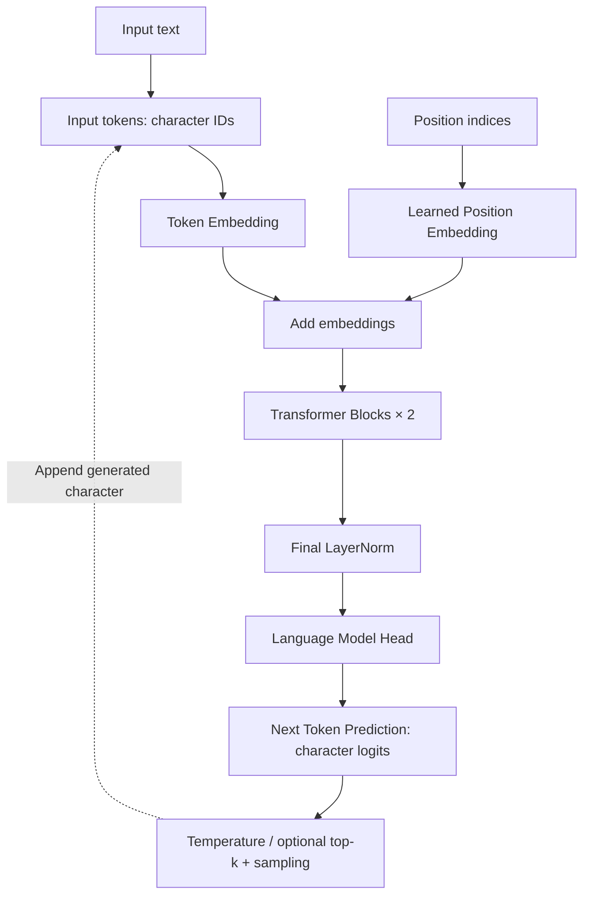

# MiniGPT

<p align="center">
  <b>A Minimal GPT Implementation from Scratch with PyTorch</b><br/>
  <i>Learn the architecture. Train a character language model. Examine the evidence.</i>
</p>

<p align="center">
  
  
  <a href="LICENSE"></a><br/>
  
  
  
</p>

<p align="center">
  <a href="#method-overview">Architecture</a> ·
  <a href="#quick-start">Quick Start</a> ·
  <a href="#experiments--results">Experiments</a> ·
  <a href="model.py">Model Code</a> ·
  <a href="docs/VALIDATION.md">Verification Record</a>
</p>

---

## Introduction

> **MiniGPT** is an educational implementation of a decoder-only Transformer for character-level language modeling. It makes the path from token embeddings to next-token prediction explicit, so learners can connect the mathematics of GPT to readable PyTorch code. The project combines a small autoregressive model, a reproducible training pipeline, controlled attention experiments, and a Gradio interface to support hands-on study of architecture, optimization, and generation.

The learning objective is to understand **how a GPT-style model works and how to evaluate it carefully**: implement causal attention, prevent data leakage, trace gradients through residual blocks, and compare design choices under a fixed training budget. Core functions include Chinese comments for guided code reading.

| Project at a glance | Recorded configuration |
|---|---|
| Task | Next-character prediction and autoregressive text generation |
| Model | 2 Transformer blocks · 64-dimensional embeddings · 4 attention heads |
| Scale | **113,920 parameters** with the recorded 76-token vocabulary |
| Stack | Python · PyTorch · Gradio |
| Execution | CPU-friendly defaults; automatic CUDA / MPS / CPU selection |
| Evidence | Saved losses, configurations, seeds, data hashes, and generation samples |

This is a learning and experimental project, not a pretrained conversational assistant or the MiniGPT-4 multimodal project.

---

## What Makes MiniGPT Special?

| Capability | What It Does |
|---|---|
| **Transformer Decoder** | Stacks pre-LayerNorm blocks with causal attention, position-wise feed-forward networks, and residual connections. |
| **Multi-head Self Attention** | Computes scaled dot-product attention with an explicit causal mask; supports single-head and multi-head configurations at the same total embedding width. |
| **Positional Embedding** | Adds learned absolute position vectors to token embeddings, giving the model information about character order. |
| **Autoregressive Generation** | Samples one character at a time with temperature, optional top-k filtering, and a local sampling seed. |
| **Training Pipeline** | Trains with AdamW, gradient clipping, periodic loss evaluation, and best/final checkpoint saving. |
| **Controlled Experiments** | Compares 1 vs. 4 heads across three paired seeds, with equal parameter counts and matching initial-weight hashes within each pair. |
| **Interactive Exploration** | Provides a Gradio interface for prompt-based generation, sampling controls, model information, and recorded loss curves. |
| **Implementation Checks** | Includes numerical attention comparisons, causal-prefix checks, gradient checks, a small-batch overfit test, and training-to-generation integration tests. |

Explore the implementation: [model](model.py) · [data pipeline](data.py) · [training](train.py) · [generation](generate.py) · [experiments](compare.py).

---

## Method Overview



**Inside each Transformer block:**

```text
x = x + CausalSelfAttention(LayerNorm(x))
x = x + FeedForward(LayerNorm(x))

FeedForward: Linear(d, 4d) → GELU → Linear(4d, d)
```

Attention uses `softmax(QKᵀ / √d_head + causal_mask)V`. Future positions are masked before softmax, so a character cannot use later input positions to predict its successor. Multiple heads are concatenated and passed through an output projection.

During training, the model minimizes cross-entropy against targets shifted by one character. During generation, it appends each sampled character and uses the most recent context window; learned positions restart at zero when that window is cropped.

**Default training configuration** — 64-character context, batch size 8, 200 updates, AdamW learning rate `3e-4`, weight decay `0.01`, gradient clipping `1.0`, dropout `0.0`, seed `42`, and two CPU threads. Configuration lives in [`ModelConfig`](model.py) and [`TrainConfig`](train.py), with training options exposed through the command line.

---

## Repository Structure

```text
minigpt-lab/
├── model.py                  # Embeddings, attention, FFN, blocks, and MiniGPT
├── data.py                   # Character tokenizer, data split, and batches
├── runtime.py                # Device selection, seeds, and environment records
├── prepare_data.py           # Public corpus download and provenance
├── train.py                  # Optimization, evaluation, and checkpoints
├── generate.py               # Autoregressive text generation
├── compare.py                # Single-head vs. four-head experiments
├── app.py                    # Gradio generation interface
├── tests/
│   ├── test_core.py          # Data and Transformer behavior
│   ├── test_pipeline.py      # Training, checkpoints, and generation
│   └── test_showcase.py      # Experiment controls and UI integration
├── scripts/
│   └── verify_app.py         # Live HTTP generation verification
├── data/
│   └── source.json           # Recorded corpus source and SHA256 hashes
├── results/
│   ├── default/              # Recorded 1,000-step demonstration run
│   ├── comparison/           # Six recorded attention-comparison runs
│   ├── smoke/                # Recorded 10-step CPU run
│   └── publication_checks.json
├── docs/
│   ├── EXPERIMENTS.md        # Experimental design, results, and limitations
│   └── VALIDATION.md         # Verification history and known boundaries
├── licenses/                 # Third-party notices and data-use information
├── .gitignore
├── requirements.txt
├── LICENSE
└── README.md
```

Model code is organized as small modules at the repository root. Downloaded text, checkpoints, and new training outputs are generated locally under `data/` and `runs/` and are excluded from Git. The published `results/` directory contains measured records, **not pretrained weights**.

---

## Quick Start

### 1. Create an environment

Use **Python 3.11 or newer**. The recorded environment is Windows 10 with Python 3.14.2 and PyTorch 2.14.1+cpu; other platforms and Python versions have not been verified.

```bash
git clone https://github.com/qinzhong631-ux/minigpt-lab.git
cd minigpt-lab
python -m venv .venv
```

<details>
<summary>Activate the environment on your platform</summary>

**Windows PowerShell**

```powershell
.\.venv\Scripts\Activate.ps1
```

**Linux / macOS**

```bash
source .venv/bin/activate
```

</details>

```bash
python -m pip install -r requirements.txt
```

For a CPU-only setup on Windows/Linux, install the corresponding PyTorch build before the remaining requirements:

```bash
python -m pip install torch==2.14.1 --index-url https://download.pytorch.org/whl/cpu
python -m pip install -r requirements.txt
```

For CUDA or macOS, follow the [official PyTorch installation guide](https://pytorch.org/get-started/locally/) for the appropriate build. Direct dependencies are pinned; the complete transitive dependency set is not locked. The publication requirements use NumPy 2.4.6, while the original experiment metadata retains the NumPy 2.4.0 version used for those runs. See the [verification record](docs/VALIDATION.md) for the dependency check and its limits.

### 2. Prepare the corpus and train

```bash
python prepare_data.py
python train.py
```

The first command downloads the public corpus and retains its original text and provenance locally. The second runs the default 200-step training configuration, automatically selecting CUDA, then MPS, then CPU when available.

A fresh clone needs this preparation and training step before generation. If the data host is unavailable, retry later or save the complete source text as `data/alice_original.txt` and rerun the preparation command. Output directories must be empty; use a new `--out` value to preserve previous runs.

### 3. Generate text and open the interface

```bash
python generate.py --prompt "Alice" --max-new-tokens 200 --temperature 0.8 --seed 42
python app.py
```

Open the local URL printed by Gradio, normally `http://127.0.0.1:7860`. The interface exposes prompt text, generation length, temperature, top-k, and sampling seed, alongside model metadata and training/validation loss curves. It binds to localhost with public sharing disabled. No API key is required.

<details>
<summary>Additional commands: CPU smoke run, custom checkpoint, and verification</summary>

```bash
# Short CPU run
python train.py --device cpu --steps 10 --out runs/smoke_new

# Load a selected checkpoint
python generate.py --checkpoint runs/smoke_new/best.pt --prompt "Alice"
python app.py --checkpoint runs/smoke_new/best.pt --port 7861

# Unit and integration tests; no downloaded corpus is required
python -m pytest -q

# After default training: start a local server and call its generation API
python scripts/verify_app.py
```

Use `python train.py --help` and `python generate.py --help` for the supported options. These commands are provided for reproduction; the historical checks are documented separately below.

</details>

---

## Experiments & Results

### Data and evaluation protocol

The recorded corpus is Lewis Carroll's *Alice's Adventures in Wonderland*, obtained from [Project Gutenberg #11](https://www.gutenberg.org/ebooks/11). It contains **144,600 characters** after extraction: the first **130,140** characters are used for training and the remaining **14,460** for validation.

The vocabulary is built from the training split only. Batch windows cannot cross the split boundary, and unseen characters map to `UNK`. The recorded validation split contains no unknown characters. Source metadata and corpus hashes are available in [`data/source.json`](data/source.json).

Training batches and evaluation windows use separate random generators. Reported evaluation losses are averages over fixed sampled windows, in **nats per character**; lower is better. The validation split also selects the best checkpoint, so it is **not an independent test set**.

### Demonstration run

| Configuration | Updates | Parameters | Final training loss | Final validation loss |
|---|---:|---:|---:|---:|
| 2 layers · 64 dimensions · 4 heads · seed 42 | 1,000 | 113,920 | 2.331909 | 2.368591 |

These are actual CPU measurements recorded on **2026-10-12**. The demonstration uses a longer budget than the default 200-step run. Inspect the [summary](results/default/summary.json), [loss history](results/default/metrics.csv), [configuration and environment](results/default/metadata.json), and [unedited generated text](results/default/sample.txt).

### Single-head vs. multi-head attention

**Question:** What changes when head count increases while total width, parameter count, and training budget remain fixed?

The experiment compares **1 vs. 4 heads**, each trained for **200 updates** using paired seeds **42, 43, and 44**. Within each pair, initial-weight hashes match and the data-sampling sequence is held constant.

| Attention heads | Parameters | Mean final validation loss | Sample standard deviation |
|---|---:|---:|---:|
| 1 | 113,920 | 2.674768 | 0.019984 |
| 4 | 113,920 | 2.677110 | 0.019667 |

**Interpretation:** The single-head configuration is slightly lower in this small experiment. The results do not establish that either configuration is generally superior. Equal parameters do not imply equal activation memory or identical computation: changing head count changes per-head dimension and the number of attention matrices.

Reproduction commands:

```bash
# Six comparison runs at the original 200-step budget
python compare.py --device cpu --steps 200 --seeds 42 43 44 --out runs/comparison_new

# Separate 1,000-step demonstration run
python train.py --device cpu --steps 1000 --seed 42 --out runs/showcase_new
```

Read the [full experiment report](docs/EXPERIMENTS.md) and [machine-readable comparison](results/comparison/comparison.json) for per-seed results, controls, and limitations.

---

## Reproducibility & Verification

Each training run saves its configuration, parameter count, seed, environment, data/source hashes, initial-weight hash, vocabulary, loss history, and best/final checkpoints. Published records preserve the original measurements while removing local absolute paths.

**Recorded publication check: 17 passed, 1 skipped.** The skipped test requires CUDA, which was unavailable in the tested CPU-only environment. This is a historical result, not a live CI badge.

Checks cover causal invariance, agreement with PyTorch's reference attention operation, gradient propagation, small-batch overfitting, checkpoint loading, seeded generation, and controlled experiment setup. The original development run also exercised Gradio's HTTP generation API. During the later publication check, a new corpus download failed with an incomplete response and HTTP 504; subsequent training/UI steps were not reported as completed in that check.

Evidence: [publication checks](results/publication_checks.json) · [validation report](docs/VALIDATION.md).

### Current limitations

- The corpus, model, and training budgets are small; generated text still contains spelling errors and incoherent sentences.
- The comparison uses one corpus and three seeds, with no independent test set or statistical significance claim.
- CUDA and MPS selection are implemented, but GPU execution and cross-platform reproducibility have not been verified.
- Checkpoints support inference; exact training resumption and KV caching are not implemented.
- Dependency resolution and an isolated NumPy update were checked; a complete fresh-environment installation was not verified.

---

## References & Acknowledgments

- **Architecture:** Vaswani et al., [Attention Is All You Need](https://arxiv.org/abs/1706.03762).
- **Implementation reference:** [karpathy/nanoGPT](https://github.com/karpathy/nanoGPT), for its compact GPT design and training/sampling organization. No nanoGPT Python source files or pretrained weights were directly copied; its [MIT notice](licenses/nanoGPT-MIT.txt) is retained.
- **Libraries:** [PyTorch](https://docs.pytorch.org/docs/stable/index.html) and [Gradio](https://www.gradio.app/docs).
- **README presentation:** [GraphMeta](https://github.com/NoWall-572/GraphMeta_for_MAS) inspired the visual hierarchy and section layout. All MiniGPT descriptions and reported results are grounded in this repository.

**AI-assisted development:** OpenAI Codex assisted with implementation, Chinese code comments, tests, documentation, and recorded execution under user-provided requirements. AI assistance is disclosed separately from the evidence of what was actually run.

## License

Original project code is released under the [MIT License](LICENSE). Third-party dependencies retain their own licenses; notices are collected in [`licenses/`](licenses/).

The corpus is not covered by the project's MIT license. Project Gutenberg identifies the work as public domain in the USA; its source text and terms are retained by the download script. Consult the [data notice](licenses/DATA_NOTICE.md) and applicable requirements before reuse or redistribution.
